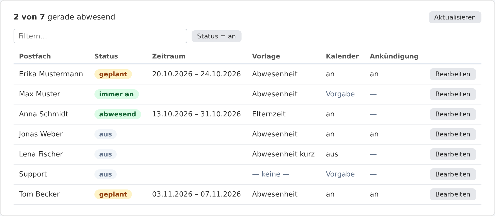
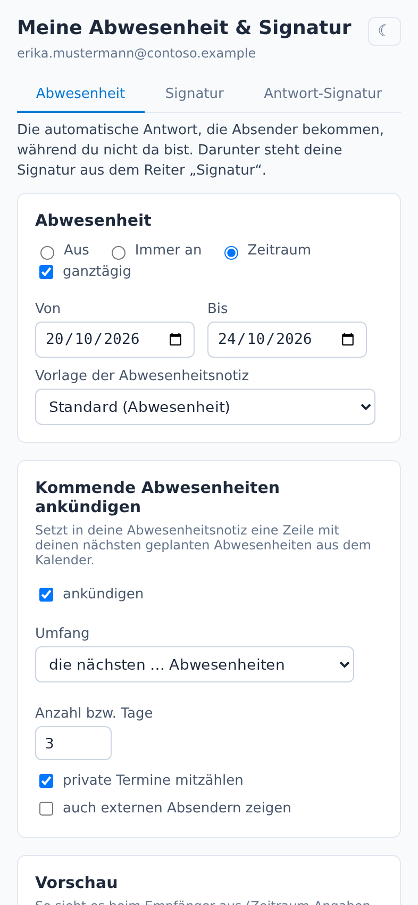
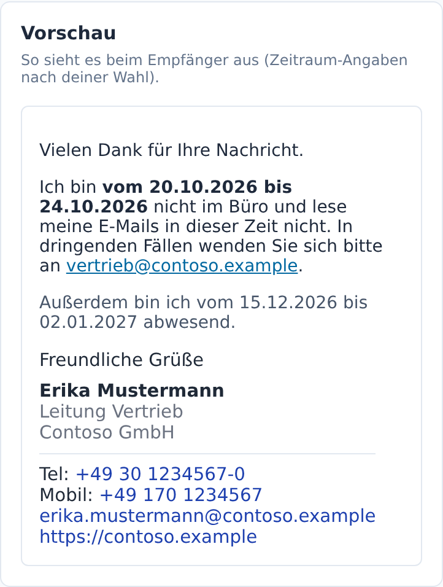
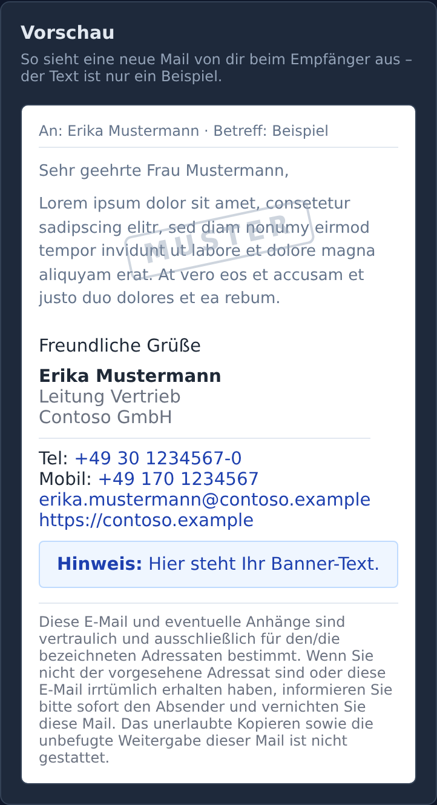
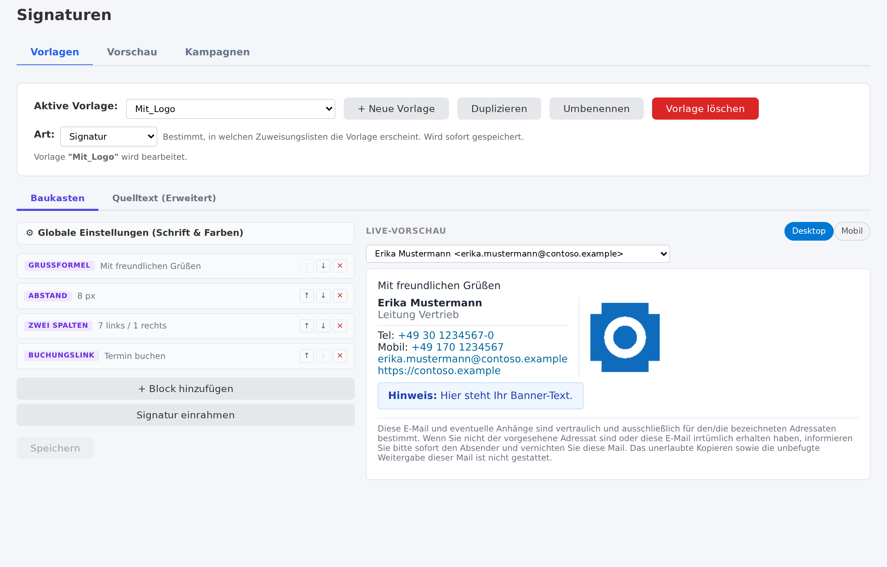
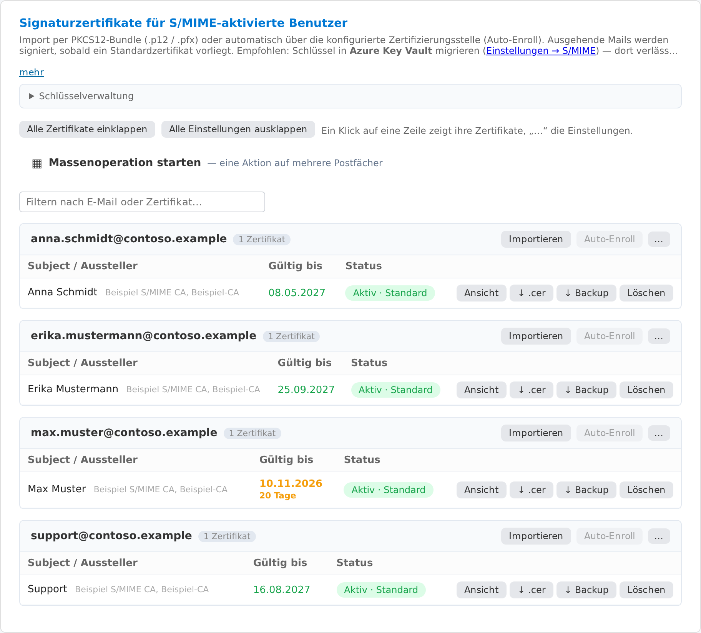

# EXO Signature Gateway

**Automatische Signaturen, Abwesenheit und S/MIME für Exchange Online: zentral
verwaltet, mit Add-ins für Outlook auf PC und Handy – bei Bedarf mit SMTP-Relay
samt Lernmodus als Ersatz für den lokalen Exchange-Server. Das alles bietet das
EXO Signature Gateway in einem Produkt – für bis zu 100 Postfächer kostenlos,
für gemeinnützige Organisationen ohne Obergrenze.**

Das Gateway hängt sich serverseitig in den Mailfluss von Exchange Online. Jede
Mail bekommt die richtige Signatur mit aktuellen Daten aus Entra ID, gleich
mit welchem Programm oder Gerät sie geschrieben wurde: Outlook, Outlook
mobil, Apple Mail auf dem iPhone, ein Drucker im Netz. Die Abwesenheitsnotiz
kommt aus denselben Vorlagen und wird zentral gesteuert. S/MIME signiert und
verschlüsselt auf Wunsch jede Mail, mit automatisch erneuerten Zertifikaten.

Selbst gehostet auf jedem Linux-Host (auch Raspberry Pi) oder vollständig in
Azure, ohne ausgehenden Port 25. Alle Daten bleiben in deinem Tenant und auf
deinem Host.

> Frei für eigene Zwecke bis 100 Postfächer, darüber mit kommerzieller Lizenz;
> gemeinnützige Organisationen ohne Obergrenze kostenlos, siehe [Lizenz](#lizenz).

---

## Was es kann

### Zentrale Abwesenheit

Die Abwesenheitsnotiz ist zentral verwaltet und bleibt trotzdem die normale
Exchange-Abwesenheit. Der Text kommt aus einer Vorlage mit Zeitraum,
Vertretung und Signatur. Ein- und ausgeschaltet wird automatisch durch
längere, als „Abwesend“ markierte Kalendertermine, manuell im Self-Service
oder zentral durch den Admin.

- **Live-Übersicht:** wer gerade abwesend ist, mit Vorlage und Zeitraum, auch
  wenn jemand die Abwesenheit selbst in Outlook gesetzt hat.
- **Aus dem Kalender:** Ein mehrstündiger, als „Abwesend“ markierter Termin
  schaltet die Abwesenheit für seinen Zeitraum ein und danach wieder aus.
  Bequem bei gepflegtem Kalender. Ab welcher Dauer, stellst du ein (4, 6, 8,
  12 Stunden oder ganztägig, Vorgabe 8). Opt-in, je Postfach übersteuerbar,
  abschaltbar bis hin zu „Kalender gar nicht lesen“.
- **Ankündigung:** Die nächsten geplanten Abwesenheiten stehen auf Wunsch im
  Text, etwa nur für interne Empfänger.

Diese Kombination aus Live-Übersicht, Kalenderkopplung, Ankündigung und
Signaturverwaltung in einem Produkt gibt es unseres Wissens bei keinem
anderen Anbieter (Stand 10/2026).



### Steuerung aus Outlook, auf PC und Handy

Zwei Outlook-Add-ins bringen das Gateway dorthin, wo geschrieben wird:

- **Self-Service:** Mitarbeitende setzen ihre Abwesenheit und wählen ihre
  Signatur und Antwort-Signatur selbst, mit Vorschau als Beispiel-Mail. Als
  App in Outlook (Web, Windows, iOS, Android) und Teams, in Outlook unter
  Windows und im Web zusätzlich als Knopf beim Lesen einer Mail. Die Anmeldung
  läuft still über das Outlook- bzw. Teams-Konto.
- **Signatur automatisch beim Verfassen:** Die Signatur steht schon beim
  Schreiben im Entwurf, in Outlook im Web, unter Windows und auf iOS und
  Android. Bei Antworten gilt dieselbe Regel wie beim Versand: die volle
  Signatur, solange deine noch nicht in der beantworteten Mail steht, danach
  die kürzere Antwort-Signatur.

Bereitstellen, in Teams für alle anheften und in Outlook selbst anheften:
[Betrieb → Outlook-Add-in und App bereitstellen](docs/betrieb.md#outlook-add-in-und-app-bereitstellen).
Fehlt im klassischen Outlook die linke App-Leiste und damit die Möglichkeit
zum Anheften, hilft der Registry-Wert `EnableAppsInOutlook = 1` unter
`HKCU\Software\Microsoft\Office\16.0\Outlook\Preferences`. Details stehen
im selben Abschnitt.

<p>



</p>

### Signaturen ohne Grenzen

- **Live-Daten aus Entra ID** je Absender beim Versand: Name, Position,
  Telefon, Abteilung, eigene Attribute.
- **Baukasten** mit Live-Vorschau, oder freies HTML. Eine vorhandene
  Signatur lässt sich übernehmen und in Bausteine zerlegen.
- **Antwort-Signatur, Banner, Disclaimer** getrennt zuweisbar, global, je
  Gruppe oder je Postfach. **Banner-Kampagnen** mit Zeitfenster und
  Zielgruppe, gepflegt von einer eigenen Rolle.
- **Saubere Antworten:** Die Signatur steht vor dem Zitat und stapelt sich
  nicht. Die Signatur, die Outlook auf dem Handy selbst anhängt, wird
  entfernt.



### S/MIME, automatisch

Signieren und verschlüsseln je Absender. Private Schlüssel können im Azure
Key Vault (HSM) liegen. Zertifikate externer Partner sammelt das Gateway aus
eingehender Post. Hat ein Empfänger kein Zertifikat, geht die Mail über ein
sicheres Web-Portal.

Woher die Zertifikate kommen:

- **Kostenlos und automatisch:** Ausstellung und Erneuerung über CASTLE ACME
  (RFC 8823), ohne Zutun der Nutzer. Die CASTLE-PKI gilt bei Empfängern
  allerdings nicht von Haus aus als vertrauenswürdig: Stimme dich vorher mit
  ihnen ab, oder nimm gleich kostenpflichtige Zertifikate.
- **Vorhandene Zertifikate:** bestehende PFX/P12-Zertifikate importieren,
  auch mehrere je Adresse.
- **Eigenes DigiCert-Konto:** Mit einem CertCentral-API-Schlüssel bestellt und
  erneuert das Gateway selbst, abgerechnet wird direkt mit DigiCert. Verfügbar,
  noch nicht im Betrieb erprobt.
- **Kostenpflichtige Zertifikate über den Signature Hub:** in Vorbereitung.
  Certum und SwissSign sind als Anbieter in Vorbereitung.



### SMTP-Relay statt lokalem Exchange

Drucker, Scanner und Fachanwendungen senden über das Gateway wie über einen
lokalen Exchange-Server. Das nimmt einem Exchange-Umzug den häufigsten Blocker.
Gedacht ist das für ein Gateway im eigenen Netz: Es erkennt die Geräte an ihrer
Adresse (Geräteliste mit Lernmodus), die Geräte bleiben unverändert, und auch
Altgeräte ohne STARTTLS oder nur mit TLS 1.0 werden angenommen.

In Azure gibt es kein Relay nach Adresse: Es setzt den Rückweg über Port 25
voraus, und den sperrt Azure ausgehend. Außerdem sähe das Gateway dort nur die
öffentliche Adresse deines Netzes, nicht die einzelnen Geräte. Es bleibt die
Einlieferung mit eigenem Login auf Port 587 (Sende-Identitäten), dafür muss
jedes Gerät umgestellt werden. Gegenüber der direkten Anbindung an Exchange
Online gewinnst du damit wenig, außer der Annahme älterer TLS-Versionen.

### Direktversand: Massenmail mit eigener IP und eigenem Ruf

Mit dem lokalen Exchange fällt auch der Weg weg, auf dem Fachanwendungen
Rundschreiben, Rechnungsläufe oder Benachrichtigungen in großer Zahl nach
außen schicken. Exchange Online ist dafür nicht gedacht: Microsoft begrenzt
die Empfänger je Tag und verweist für Massenversand auf
[Drittanbieter](https://learn.microsoft.com/en-us/office365/servicedescriptions/exchange-online-service-description/exchange-online-limits).
Der eigene Dienst dafür, Azure Communication Services Email, nimmt seit dem
23.10.2026 keine neuen Kunden mehr an und endet am 30.09.2028.

Das Gateway stellt Post an externe Empfänger auf Wunsch selbst zu, über einen
eigenen Postfix: von deiner IP, mit deinem Ruf, zu deinen Bedingungen und ohne
Microsofts Sendegrenzen. Zusammen mit dem SMTP-Relay ersetzt es den lokalen
Exchange-Server auch hier. Die Anwendung liefert im eigenen Netz beim Gateway
ein, und Exchange Online ist am Versand nicht beteiligt.

- **DKIM im Gateway:** je Absenderdomäne ein Schlüssel, der DNS-Eintrag zum
  Kopieren. Signiert wird mit der Domäne im `From:`, auf die DMARC achtet.
- **DNS-Prüfung wie beim Empfänger:** SPF vollständig ausgewertet (auch über
  `include`), DKIM-Eintrag, PTR und HELO-Name, DMARC-Richtlinie. Wo etwas
  fehlt, steht der passende Eintrag zum Kopieren daneben.
- **Postfix erledigt den Zustellbetrieb:** MX mit Ausweichen, Warteschlange,
  Wiederholung bis zu fünf Tage, Unzustellbarkeitsberichte. Die Relay-Seite
  zeigt Zustellungen, Rückstellungen und die letzten Zustellprobleme.
- **Was hinausgeht, bestimmst du:** alle externen Empfänger oder einzelne
  Domänen. Interne Post bleibt bei Exchange Online.

Voraussetzungen: Betrieb im eigenen Netz oder bei einem Hoster mit offenem
ausgehendem Port 25 (in Azure ist er gesperrt), Rückweg-Modus *SMTP Port 25*
und am besten ein eigener PTR-Eintrag für die Ausgangsadresse. Abmeldelinks
und die Auswertung von Rückläufern bleiben Sache der versendenden Anwendung.
Erkennt ein Inbound-Connector deines Tenants die Ausgangsadresse an der IP
(etwa der eines separaten Relays), ordnet Microsoft Post an Empfänger in
Microsoft 365 deinem Tenant zu und schickt sie über dein Exchange Online. Der
Connector des Gateways prüft das Zertifikat und ist davon nicht betroffen.

### Betrieb

Einrichtungsassistent mit automatischer App-Registrierung, Abnahme der ganzen
Anlage, Prüfung und Nachtrag der Berechtigungen, Postfach-Status,
Dashboard, Anmeldung über Entra ID mit Rollen, Update und Backup in der
Oberfläche, hell und dunkel, bedienbar ab 320 px Breite.

Alle Funktionen im Einzelnen: **[docs/funktionen.md](docs/funktionen.md)**

---

## So funktioniert es

```
Outlook, Handy, Gerät ──► Exchange Online ──► Gateway ──► Exchange Online ──► Empfänger
                                                │
                                   Signatur, Banner, Disclaimer,
                                   S/MIME — Daten per Graph aus Entra ID
```

Eine Transportregel in Exchange Online leitet die Post der aktivierten
Postfächer an das Gateway. Es fügt Signatur, Banner und Disclaimer ein,
signiert und verschlüsselt auf Wunsch und gibt die Mail an Exchange zurück:
über SMTP oder, in Azure, über Microsoft Graph. Outlook und andere Programme
sprechen weiter nur mit Exchange.

Details zu Rückweg, Ports und Größe des Hosts: **[docs/betrieb.md](docs/betrieb.md)**

---

## Schnellstart

```bash
git clone https://github.com/azitc-ac/EXO-Signature-Gateway.git
cd EXO-Signature-Gateway
mkdir -p data certs && sudo chown -R 1000:1000 data certs templates
docker compose up -d --build
```

1. `http://<IP-des-Hosts>` öffnen und das TLS-Zertifikat einrichten (Let's
   Encrypt oder eigenes).
2. `https://<dein-hostname>` öffnen, mit `admin` / `admin` anmelden und ein
   neues Passwort setzen.
3. Der Einrichtungsassistent legt die App-Registrierung in Entra ID an und
   richtet Connector, Transportregel und Verteilerliste in Exchange Online ein.

In Azure geht es ohne Kommandozeile: [](https://portal.azure.com/#create/Microsoft.Template/uri/https%3A%2F%2Fraw.githubusercontent.com%2Fazitc-ac%2FEXO-Signature-Gateway%2Fmain%2Fdeploy%2Fazure%2Fazuredeploy.json/createUIDefinitionUri/https%3A%2F%2Fraw.githubusercontent.com%2Fazitc-ac%2FEXO-Signature-Gateway%2Fmain%2Fdeploy%2Fazure%2FcreateUiDefinition.json)
legt VM, statische IP und Firewall an und installiert das Gateway.

Voraussetzungen, Azure-VM per Vorlage oder Skript, Betrieb vor Ort und Berechtigungen:
**[docs/installation.md](docs/installation.md)**

---

## Dokumentation

| | |
|---|---|
| [Funktionen](docs/funktionen.md) | Signaturen, Zuweisung, Abwesenheit, Self-Service, S/MIME, Vorlagen und Variablen, Mail-Typen |
| [Installation](docs/installation.md) | Voraussetzungen und Berechtigungen, Schnellstart, Azure, Betrieb vor Ort, Let's Encrypt |
| [Betrieb](docs/betrieb.md) | Ablauf, Ports, Rückweg-Modi, Domänen-Routing, Sende-Identitäten, Größe des Hosts, Oberfläche, Add-ins bereitstellen, Datenspeicherung, Architektur |
| [CHANGELOG](CHANGELOG.md) | Alle Änderungen, mit „Zu tun“ für bestehende Installationen |
| [SECURITY](SECURITY.md) | Sicherheitslücken melden |

---

## Lizenz

[PolyForm Internal Use License 1.0.0](LICENSE.md) (Community Edition): frei
nutzbar für eigene und interne Zwecke, auch im Unternehmen, für **bis zu 100
Postfächer**. Darüber hinaus ist eine kostenpflichtige kommerzielle Lizenz
erforderlich, Kontakt: alexander@zarenko.net. Unabhängig von der Größe nicht
erlaubt ist die Weiterverteilung.

**Betrieb:** In der eigenen Umgebung der Organisation (eigene Server oder ein
Cloud-Abonnement auf ihren Namen) betreibt sie das Gateway selbst oder lässt es
von einem Dienstleister ihrer Wahl betreiben. Als Managed Service in einer
fremden Umgebung betreiben es nur der Lizenzgeber oder ein von ihm schriftlich
autorisierter Partner. Das gilt für alle Editionen.

**Gemeinnützige Organisationen** nutzen das Gateway kostenlos und ohne
Postfach-Obergrenze (Nonprofit Edition). Voraussetzung ist die Anerkennung bei
Microsoft for Nonprofits, ein Freistellungsbescheid oder eine gleichwertige
Anerkennung im eigenen Land, unabhängig von Größe und Rechtsform. Ab dem 101.
Postfach gibt es dafür eine kostenlose Nonprofit-Lizenz mit zwölf Monaten
Laufzeit, die mit neuem Nachweis verlängert wird. S/MIME-Zertifikate bleiben
kostenpflichtig. Einzelheiten in [LICENSE.md](LICENSE.md).
