# Funktionen im Detail

[README](../README.md) · [Funktionen](funktionen.md) · [Installation](installation.md) · [Betrieb](betrieb.md)

## Signaturen
- **Live-Absenderdaten über Graph** — Anzeigename, Position, Abteilung, Telefon/Mobil, Büro, Firma, Website, Bookings-Link und eigene `extensionAttributes`, je Absender zum Sendezeitpunkt abgerufen.
- **Volles HTML** über Jinja2-Vorlagen — ohne die Grenzen der EXO-Transportregeln.
- **Signatur-Baukasten** — Signaturen aus Bausteinen zusammensetzen (Name, Kontaktzeilen, Logo, Trennlinie, Zwei-Spalten, Kasten mit runden Ecken, Social-Links, Anschrift, Badge, freies HTML) mit Live-Vorschau in der Weboberfläche.
- **HTML → Baukasten (Rück-Konvertierung)** — bestehendes Signatur-HTML wird in bearbeitbare Bausteine zerlegt: eine vorhandene Signatur übernehmen statt neu bauen.
- **Eingebettete Logos** — hochgeladene Bilder werden als Base64-Data-URI eingebettet (kein externes Hotlinking; rendert in Outlook und offline).
- **Banner & Disclaimer** — eigene Banner- und Disclaimer-Vorlagen, unabhängig von der Signatur zuweisbar. Sie kommen immer vom Gateway beim Versand, auch wenn die Signatur schon beim Verfassen eingefügt wurde.
- **`#nosig` im Betreff** — die Mail geht ohne Signatur hinaus; einstellbar, ob Banner und/oder Disclaimer trotzdem bleiben. Dasselbe lässt sich für Antworten in einer schon signierten Kette festlegen.

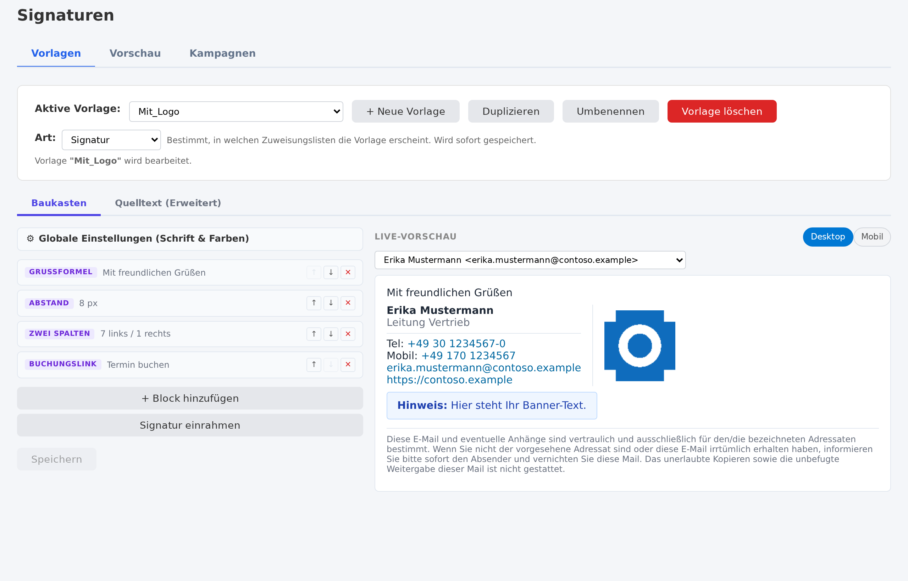

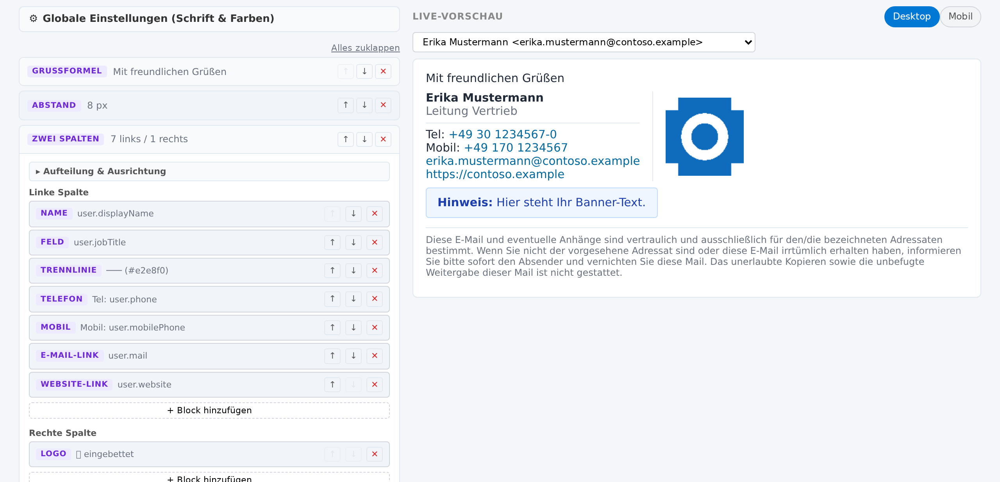

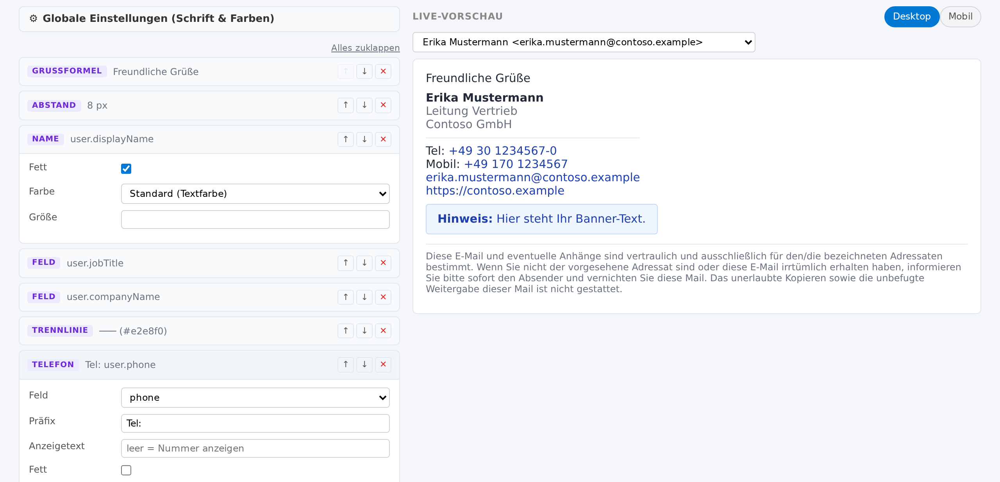

## Zuweisung & Richtlinien
- **Pro Postfach oder per Richtlinie** — Signatur, Antwort-Signatur, Banner, Disclaimer und Add-in-Vorlage global, je Postfach oder je **Gruppe** zuweisen (interne Postfach-Gruppen, „erste Regel gewinnt").
- **Antwort-/Minimalsignatur** — kürzere Signatur für Antworten innerhalb eines Threads.
- **Banner-Kampagnen** — ein Banner mit Start/Ende und optionaler Zielgruppe, das für seine Laufzeit Vorrang vor dem regulären Banner hat; pflegbar von einer eigenen Rolle *Kampagnen-Manager* ohne Admin-Rechte.

## Abwesenheit (Out of Office)
Zuschaltbar unter *Einrichtung → Modus & Funktionen* (Vorgabe aus).

Die Abwesenheit ist zentral verwaltet und trotzdem die ganz normale Exchange-Abwesenheit: Die Übersicht liest den **Live-Zustand aus Exchange** — auch Abwesenheiten, die jemand selbst in Outlook gesetzt hat —, zeigt die gewählte Vorlage, den Zeitraum und die Kalenderkopplung und lässt neue Abwesenheiten direkt setzen. Text, Signatur und Banner kommen aus denselben Vorlagen wie die Signaturen. Diese Kombination aus Live-Übersicht, Kalenderkopplung, Ankündigung künftiger Abwesenheiten und Signaturverwaltung in einem Produkt gibt es unseres Wissens bei keinem anderen Anbieter (Stand 10/2026).

- **Einheitlicher Abwesenheitstext** — eine Vorlage der Art *Abwesenheit* (Baukasten wie bei Signaturen, mit Zeitraum-Platzhaltern und der Signatur darunter) wird per Graph in die native Exchange-Abwesenheit geschrieben. Ein- und ausgeschaltet wird wie gewohnt in Outlook oder im Self-Service; Exchange verschickt die Antwort selbst.
- **Zuweisung** global, je Gruppe oder je Postfach — wie bei Signaturen.
- **Aus dem Kalender** (opt-in, je Postfach übersteuerbar) — ein Termin „Abwesend“ schaltet die Abwesenheit für seinen Zeitraum ein.
- **Ankündigung künftiger Abwesenheiten** — `{{ oof.ankuendigung }}` / `{{ oof.announcement }}` setzt die nächsten geplanten Abwesenheiten aus dem Kalender in den Text, wahlweise nur für interne Empfänger.
- **Übersicht für Admins** — Seite *Abwesenheit*: wer gerade abwesend ist, mit Vorlage, Zeitraum und Kalenderstatus; je Postfach zentral bearbeitbar.
- **Auch für abgelegte Post** — im Modus Graph++ antwortet das Gateway selbst auf Post von außen, die per IMAP abgelegt wird (siehe [Graph++](installation.md#betrieb-auf-azure-kein-ausgehender-port-25)).

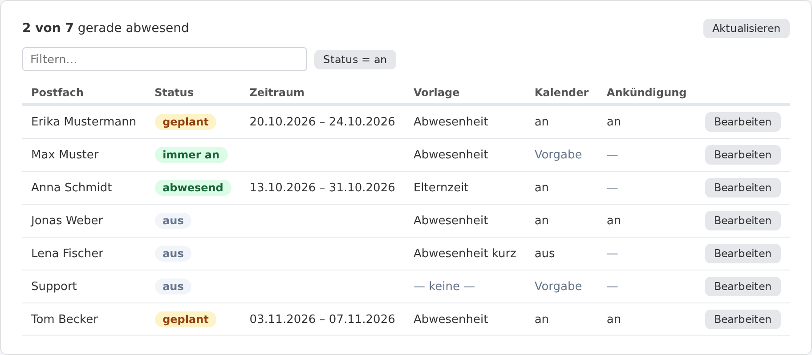

## Self-Service für Mitarbeitende
- **Eigene Abwesenheit und Signatur** — drei Reiter: *Abwesenheit* (an/aus, Zeitraum, Vorlage), *Signatur* (unter jeder neuen Mail und ggf. unter der Abwesenheitsnotiz) und *Antwort-Signatur* (ab der 2. eigenen Mail im Verlauf, auch *keine*). Jeder Reiter hat eine eigene Vorschau als Beispiel-Mail und einen eigenen Speichern-Knopf. Die Wahl der eigenen Vorlagen ist standardmäßig gesperrt und je Postfach oder Gruppe freischaltbar.
- **Drei Zugänge, eine Seite** — im Browser unter `/self`, als Knopf beim Lesen einer Mail im Outlook-Add-in und als App in der linken Leiste von Outlook (Web, Windows klassisch und neu, iOS, Android) und Teams. Die App wird als Paket unter *Integrierte Apps* hochgeladen.
- **Anmeldung über Entra ID**; die Self-Service-Rolle erreicht nur das eigene Postfach. In der App in Outlook und Teams läuft die Anmeldung still über die Anmeldung der App (Nested App Authentication), ein Anmeldefenster erscheint nur noch als Rückfall. Schalter `SELF_SERVICE_ENABLED` (Vorgabe aus): ohne ihn ist die Seite reine Anzeige.
- **Hell oder dunkel** — nach eigener Wahl (Knopf oben rechts), sonst nach dem Design von Teams bzw. Outlook oder des Systems. Die Vorschau der Mail bleibt hell, so wie der Empfänger sie sieht.

<p>
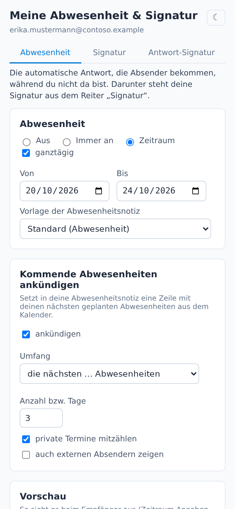
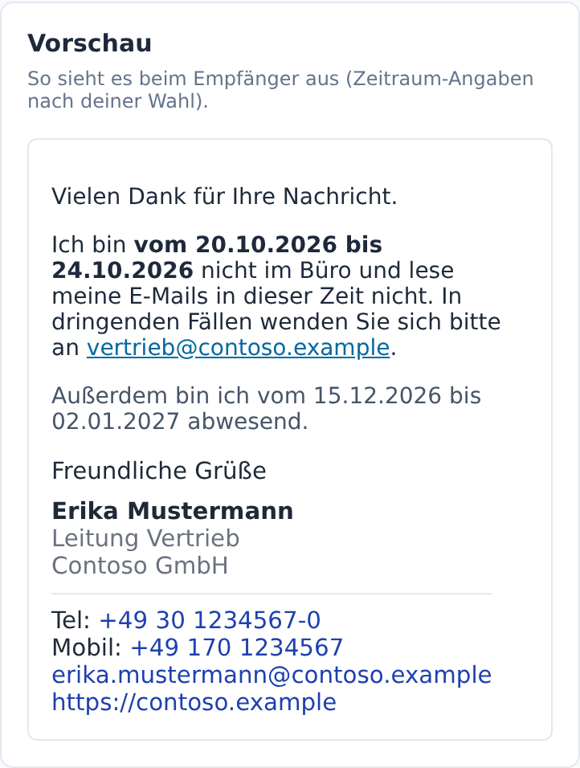
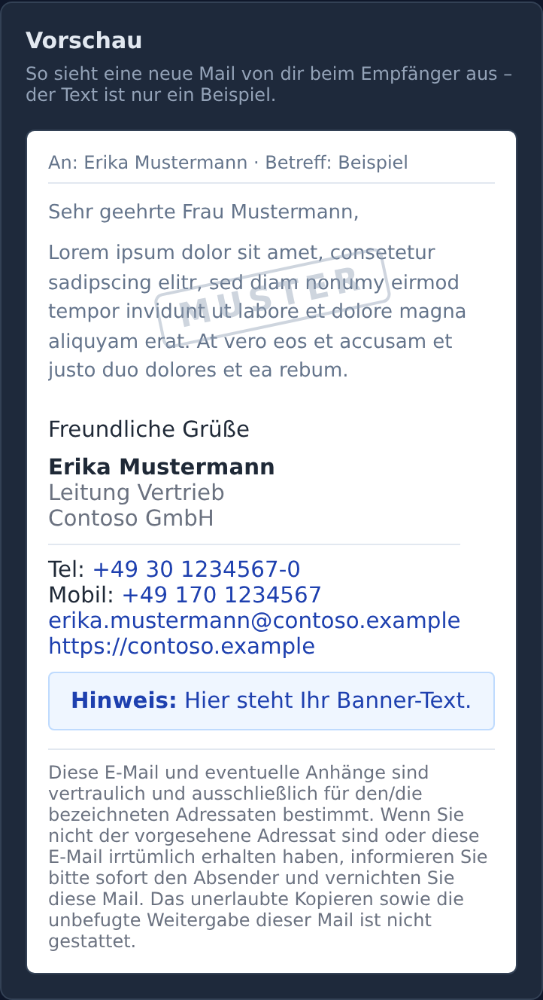
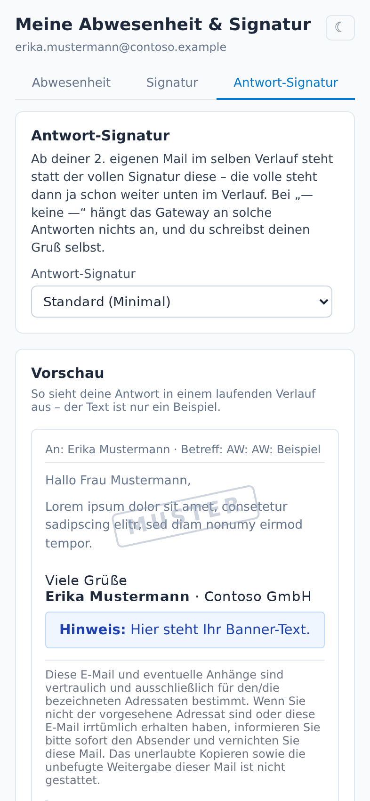
</p>

## Intelligente Mailverarbeitung
- **Antworterkennung** — die Signatur steht vor dem zitierten Text, nicht gestapelt am Ende; eine bereits im Thread vorhandene Signatur wird nicht doppelt eingefügt.
- **Client-Signaturen entfernen** — von Outlook Mobile u. a. hinzugefügte Signaturen werden erkannt und entfernt.
- **Gemischte interne/externe Empfänger** — von Exchange in Teilnachrichten aufgeteilte Sendungen (Bifurkation) werden korrekt an jeden Empfänger zugestellt, mit vollständiger Empfängerliste (Antwort-an-Alle funktioniert) — **auch in Azure ohne Port 25**, über SMTP-Einlieferung auf Port 587.
- **Alle gängigen Mailtypen** — HTML, Nur-Text und TNEF/winmail.dat (Outlook-RTF).

## S/MIME
- **Signieren und/oder Verschlüsseln je Absender**, in jedem Reinject-Modus.
- **Eigene Zertifikate** — bestehende PFX-Zertifikate importieren (mehrere je Adresse möglich).
- **Azure Key Vault (HSM)** — private Schlüssel können im Key Vault liegen; signiert wird über die Key-Vault-Sign-API, der Schlüssel verlässt das HSM nie.
- **Automatischer Zertifikats-Lebenszyklus** — vollautomatische Ausstellung und Erneuerung über CASTLE ACME (RFC 8823), ohne Nutzerinteraktion. *Kommerzielle öffentliche S/MIME-Zertifikate über einen Zertifikats-Hub sind in Vorbereitung.*
- **Empfänger-Zertifikate einsammeln** — öffentliche Zertifikate externer Korrespondenten werden aus eingehender signierter Post gewonnen, sodass sich später ohne manuellen Import an sie verschlüsseln lässt.
- **Secure Message Portal** — hat ein Empfänger kein Zertifikat, kann verschlüsselte Post über ein sicheres Web-Portal (mit E-Mail-Einmalcode) zugestellt werden, statt zu scheitern oder im Klartext zu gehen.

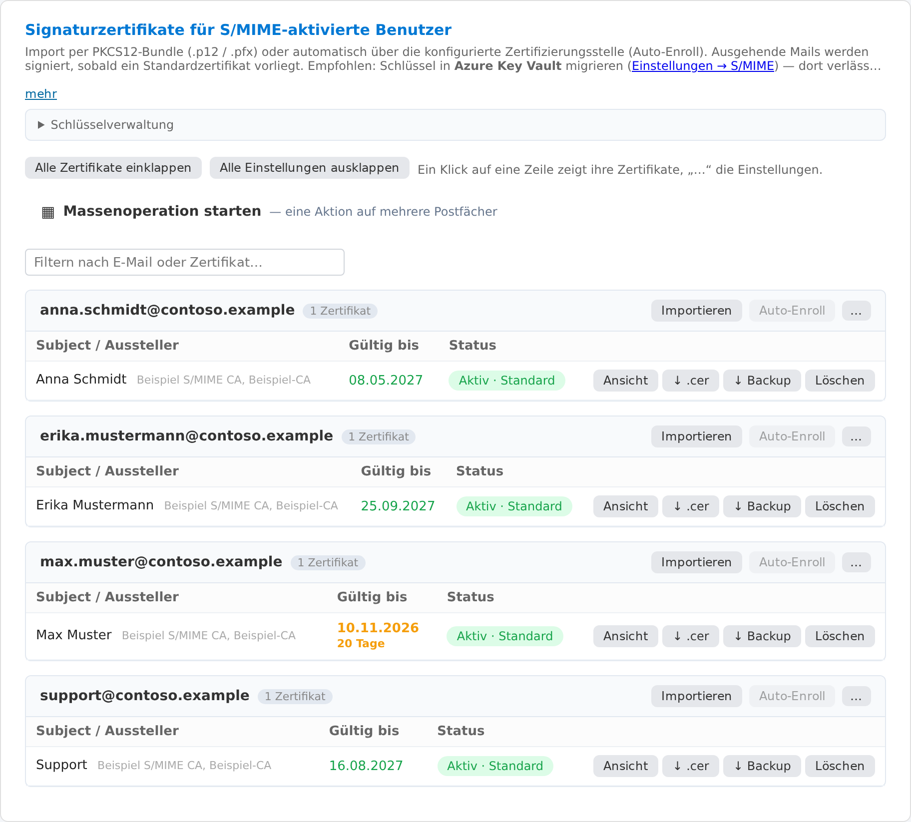

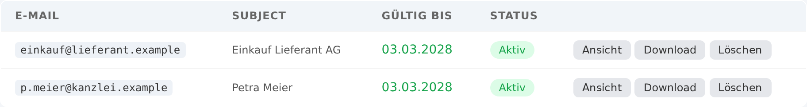

## Betrieb
- **Massenoperationen** — viele Postfächer auf einmal aktivieren und Zertifikate für viele zugleich bestellen/ausrollen (mit Vorschau und Kontingentprüfung).
- **SMTP-Relay** — Geräte im eigenen Netz (Drucker, Scanner, Fachanwendungen) senden über das Gateway wie über einen lokalen Exchange-Server.
- **Outlook-Add-in** — Signatur direkt im Outlook-Verfassenfenster vorschauen und auswählen; beim Lesen öffnet es den Self-Service. Der Bereich lässt sich anheften; im klassischen Outlook steht der Knopf auch ohne ausgewählte Mail bereit.
- **Signatur automatisch beim Verfassen** — ein zweites Add-in fügt die Gateway-Signatur ein, sobald eine Mail beginnt: in Outlook im Web, unter Windows (klassisch und neu) sowie in Outlook für iOS und Android (ab Version 4.2433). Bei Antworten und Weiterleitungen gilt dieselbe Regel wie im Gateway: volle Signatur beim ersten eigenen Beitrag, danach die Antwort-Signatur. Die Anmeldung läuft still, ohne Fenster.
- **Abnahme** — *Einrichtung → Verbindungstest & Abnahme* prüft die Anlage als Ganzes (Außenadresse, TLS, Anmeldung, Exchange-Rechte, Postfächer, Rückweg, Vorlagen, Benachrichtigung, Add-in-Anmeldung) und nennt bei jeder Lücke, was zu tun ist.
- **Berechtigungen prüfen und nachtragen** — der Assistent zeigt je Berechtigung der App-Registrierung, ob sie tatsächlich erteilt ist, und trägt fehlende per Admin-Anmeldung nach, ohne Secret und Zertifikat zu ändern.
- **Anpassbare Mails an Nutzer** — Portal-Benachrichtigung, Portal-Antwort und Erneuerungsaufforderung sind Vorlagen im selben Editor wie die Signaturen.
- **Anmeldung und Rollen** — Anmeldung über Entra ID mit den Rollen Admin, Bearbeiter (Vorlagen), Kampagnen-Manager und Self-Service; ein lokaler Notfallzugang bleibt.
- **Dashboard & Überwachung** — Mailstatistik, S/MIME-Zähler, Zertifikatsablauf, RAM/Platte/Log-Überwachung.
- **Selbst gehostet oder in Azure** — jeder x64/ARM64-Host (auch Raspberry Pi) oder vollständig in Azure ohne ausgehenden Port 25.
- **Hell-/Dunkelmodus**, nutzbar bis 320 px Breite.
- **Nicht in Suchmaschinen** — jede Antwort der Weboberfläche trägt `X-Robots-Tag: noindex, nofollow`.

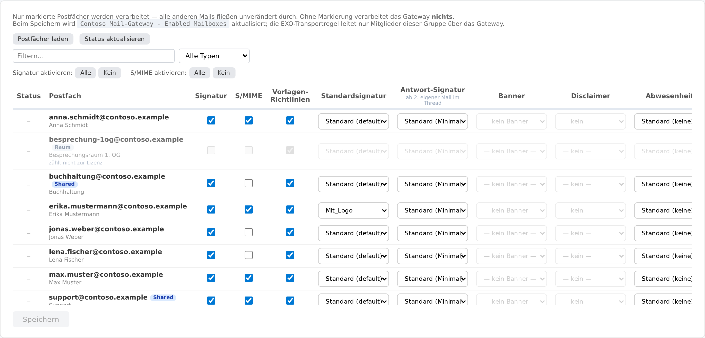

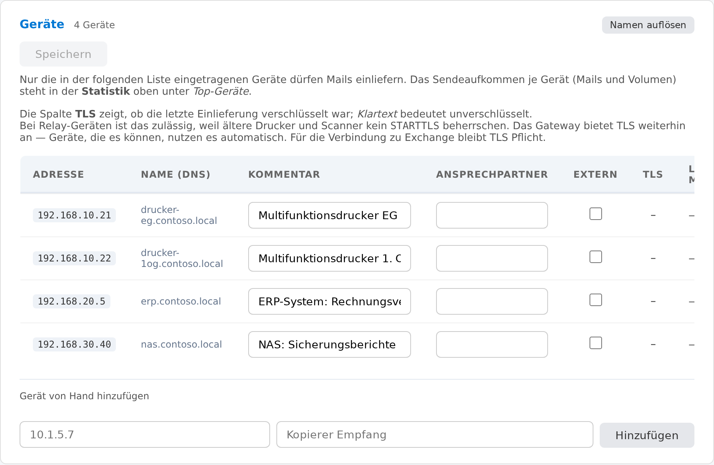

---

## S/MIME Signierung & Verschlüsselung

Mails können pro Absender digital signiert und/oder verschlüsselt werden.

1. PFX-Zertifikat über die Web-UI unter **S/MIME → Importieren** hochladen
2. Zertifikat wird dem Absender automatisch zugeordnet; mehrere Zertifikate pro Adresse möglich
3. Funktioniert in allen Modi (Graph, IMAP, SMTP)

**Azure Key Vault Integration:**  
Private Schlüssel können optional in Azure Key Vault gespeichert werden. Das Gateway signiert dann via Key Vault Sign API – der private Schlüssel verlässt das HSM nie. Fallback-Modus (`KV_KEY_MODE=fallback`) erlaubt lokale Backup-Kopie als Ausfallsicherung.

Für die Verschlüsselung werden Empfänger-Zertifikate separat verwaltet (Bereich "Empfängerzertifikate").

---

## S/MIME Zertifikat-Lifecycle & Auto-Enrollment (CASTLE ACME)

Das Gateway überwacht Zertifikatsablaufdaten und kann Erneuerungen anstoßen. Pro Benutzer ist ein CA-Backend konfigurierbar.

### Verfügbare Backends

| Backend | Typ | Beschreibung |
|---|---|---|
| **Assisted Manual** | manuell | Benutzer erhält E-Mail mit Link zum CA-Portal und Self-Service-Upload-Link |
| **CASTLE Platform (RFC 8823)** | vollautomatisch | ACME-Auftrag wird automatisch platziert, Zertifikat wird ohne Benutzerinteraktion importiert |

### CASTLE ACME – Ablauf

```
Gateway          CASTLE ACME              Exchange Online (Postfach)
   │                  │                           │
   │── new-order ────►│                           │
   │◄── authz ────────│                           │
   │                  │── Challenge-E-Mail ───────►│
   │                  │   Subject: "ACME: <token>" │
   │◄── Graph API inbox poll (alle 30 s) ─────────│
   │── Graph sendMail (Re: ACME: …) ──────────────►│
   │                  │   (Exchange → Connector → Gateway → rebuild → CASTLE MX)
   │                  │◄── RFC 8823-konforme Antwort
   │── trigger_challenge ──►│                      │
   │── finalize (CSR) ─────►│                      │
   │◄── Zertifikat (PEM) ───│                      │
   │── importiert Zertifikat, Admin-Benachrichtigung
```

**Warum Graph API Polling statt SMTP-Intercept:**  
Der MX-Record der Betreiberdomain zeigt auf Exchange Online — die Challenge-E-Mail geht direkt ins Postfach, ohne den Gateway zu passieren. Das Gateway pollt daher aktiv das Postfach via Graph API.

**Kein Port 25 / kein ACS nötig:**  
Die Challenge-Antwort wird per `Graph sendMail` gesendet. Exchange routet die Antwortmail über den Outbound-Connector zurück durch das Gateway — der Handler erkennt `Subject: Re: ACME:` und baut ein RFC 8823-konformes MIME mit CRLF neu auf. Damit gelangt die Antwort zu CASTLE – ohne direkten Port-25-Zugang.

---

## Signatur-Templates

Signaturen lassen sich auf zwei Wegen pflegen:

- **Baukasten** — ein visueller Editor in der Oberfläche setzt die Signatur aus
  Bausteinen zusammen (Name, Kontaktzeilen, Logo, Trennlinie, Zwei-Spalten,
  Kasten mit runden Ecken, Social-Links, Anschrift, Badge, freies HTML) mit
  Live-Vorschau. Logos werden als Base64-Data-URI **eingebettet**. Bestehendes
  Signatur-HTML kann eingefügt werden und wird **zurück in Bausteine zerlegt**
  (Rück-Konvertierung), sodass sich eine vorhandene Signatur übernehmen lässt.
  Banner und Disclaimer sind eigene Vorlagen und getrennt zuweisbar.
- **HTML/Plaintext direkt** — die Vorlagen liegen unter `./templates/`, sind per
  Volume gemountet und wirken sofort ohne Rebuild.

Zugewiesen werden Signatur, Antwort-Signatur, Banner und Disclaimer global, je
Postfach oder per **Richtlinie/Gruppe** (interne Postfach-Gruppen,
„erste Regel gewinnt").

### Verfügbare Jinja2-Variablen (`{{ user.* }}`)

| Variable | Quelle |
|---|---|
| `user.displayName` | Graph `displayName` |
| `user.jobTitle` | Graph `jobTitle` |
| `user.department` | Graph `department` |
| `user.companyName` | Graph `companyName` |
| `user.mail` | Graph `mail` |
| `user.phone` | Graph `businessPhones[0]` |
| `user.mobilePhone` | Graph `mobilePhone` |
| `user.officeLocation` | Graph `officeLocation` |
| `user.website` | `USER_WEBSITES`-Override → `businessHomePage` → `extensionAttribute1` |
| `user.bookingsUrl` | `USER_BOOKINGS`-Override → `extensionAttribute2` |

**Eigene Variablen:** Zusätzlich lassen sich in der Oberfläche eigene Felder
definieren, die aus einem beliebigen Entra-Attribut gefüllt werden — im Template
als `{{ custom.<name> }}` verfügbar. Einzelne Werte können pro Postfach
überschrieben werden.

---

## Mail-Typen

Das Gateway verarbeitet alle gängigen MIME-Formate korrekt:

- **HTML-Mails** – Signatur wird vor `</body>` eingefügt
- **Nur-Text-Mails** – werden zu `multipart/alternative` konvertiert (Text + HTML)
- **TNEF/Winmail.dat** (Outlook RTF) – wird entpackt, HTML-Body extrahiert oder aus Plaintext rekonstruiert
- **Multipart-Mails** – HTML- und Textteile werden jeweils separat ergänzt

---

## Gesendete Elemente (Sent Items)

Wenn `SENT_ITEMS_UPDATE` aktiviert ist, patcht das Gateway nach dem Versand die Mail in den Gesendeten Elementen des Absenders mit der signierten Version.

**Voraussetzung:** `Mail.ReadWrite` Application Permission mit Admin Consent.
